# Vantage

Vantage is an Ashita v4 addon for Phoenix. It shows buffs, debuffs and recasts as bars, icons and text for you, your target, your party and the enemies you watch. Choose what shows, change how it looks, and put each display wherever you want it.

Author: **Kipling**.

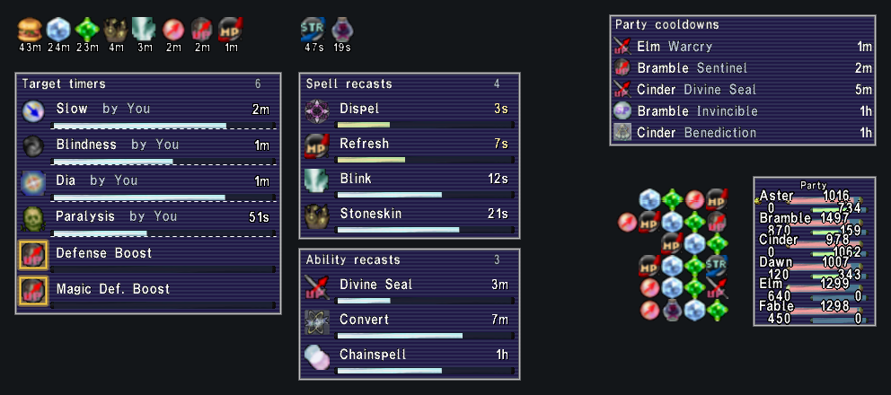

*An example layout with sample effects.*

[Download the latest release](https://github.com/KiplingFFXI/vantage/releases) | [Full guide](docs/GUIDE.md) | [What's changed](CHANGELOG.md)

## Install or update

1. Download `vantage-<version>-addon.zip` from the release page.
2. Copy the `addons/vantage` folder from the zip into your Phoenix `addons` folder. You should end up with `addons/vantage/vantage.lua`. If you're updating, move the old `addons/vantage` folder out of the game folder first so no old files get mixed in.
3. In game, type `/addon load vantage`. If Vantage is already loaded, type `/addon reload vantage` instead.

The game can stay open while you do this. To load Vantage automatically, enable vantage under **Manually installed** on the Phoenix launcher's Addons page. Or add `/addon load vantage` to `scripts/default.txt`, outside the launcher's managed block. Use one method.

Leave `config/addons/vantage/` where it is when you update. It holds each character's settings, your profiles, shared layouts, and your custom fonts and sounds. The [install notes](docs/INSTALL.md) have the full steps and show how to remove Vantage.

## Start here

Type `/vg` to open the main page (`/vantage` works too). Your own buffs, your own debuffs and your target's timers start on. Tick anything else you want under **What to show**, or apply a **Starter profile** for your role. Pick a **Skin** and a **Size** under **How it looks**, and click **Edit** beside a display to open its full editor.

- Every display starts locked. Click **Unlock all** under **Moving** or type `/vg unlock`, then hold Shift until the handles show up. Drag the middle of a display to move it, or drag an edge or corner to resize it. With **Grid mode** on, the displays you tick for it snap to the grid, to other displays, to the party list and to chat.
- **Show samples** fills the displays with made-up effects so you can arrange them before a fight.
- **Find a setting** at the top finds any control, even on a tab you haven't opened. **Undo** and **Redo** step through your changes, and **Profiles** saves named setups that any character can load.
- If something looks wrong, `/vg report` writes down what Vantage found. [Check it](docs/INSTALL.md#check-it) says what the report covers.

## What it can show

### Timer panels

There's a separate panel for your own buffs, your own debuffs, your target, party members and the enemies you choose to watch. Each panel has its own layout (bars, expanded bars, icons or text), fill direction, fields, sorting, filters, colors and placement.

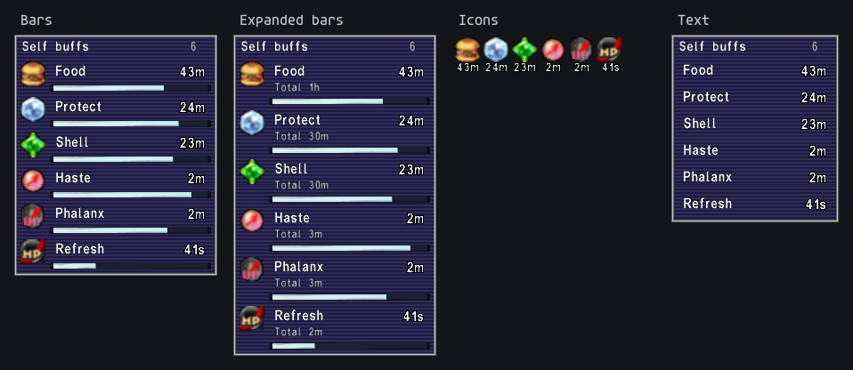

*The four timer layouts.*

If you turn it on, a mob's buff lights up on your target and watched enemies when your job can take it off right now. A debuff lights up the same way when you can cleanse it as a White Mage, main or support job: Paralysis once you've learned Paralyna, Silence once you've learned Silena, and so on through the other -na spells, Cursna and Erase. That works on Self debuffs, Party members' timers, the buffs beside the party list and overhead icons.

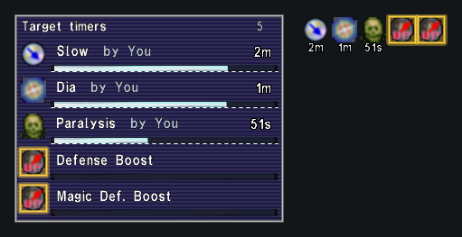

*A mob buff your job can remove now.*

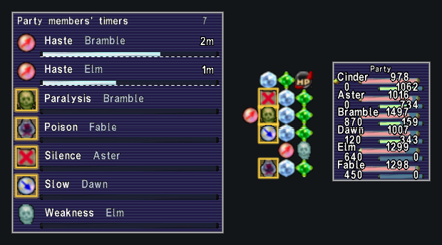

*Debuffs a White Mage can cleanse now.*

**Timer durations** lets you set your own time for a spell, ability or effect, or make it count up. If you turn it on, it also learns times from your own casts.

### Recasts

Vantage shows recasts for spells, abilities and equipped enchanted items. They can go in separate panels or one combined panel, as bars, expanded bars, icons or text. You can set alerts for when a recast starts, when it's ready, and for its remaining time. If you turn them on, rows tint while you can't afford a spell or you're Silenced or Amnesia'd, and a long recast pulses when it's ready.

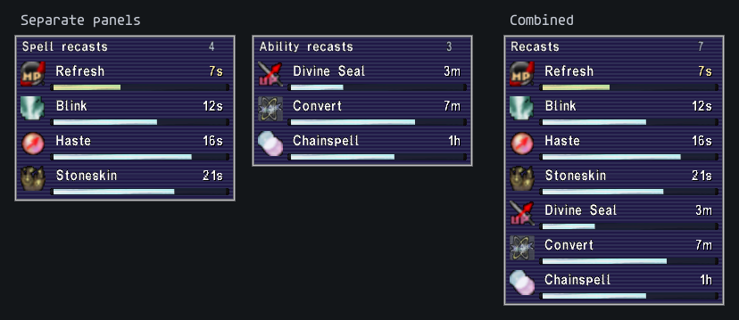

### Party and alliance

**Party members' timers** show the effects on your party, on bars that say whose effect each row is.

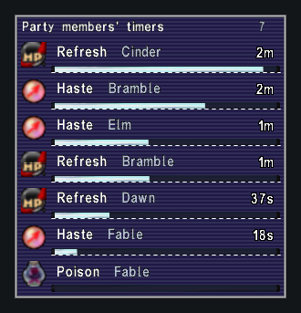

**Buffs beside the game's party list** cover your party and each of the other alliance parties, and each one has its own switch. A row grows as it gets more buffs, and each group can go in a panel of its own that you place yourself.

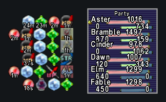

*Beside the game's party list.*

Both can show only the effects job abilities put on your party, such as Berserk, rolls and blood pacts. Tick **Only effects from job abilities** on their **Filters** tab.

**Party cooldowns** start off. They show the two-hours and key abilities your party and alliance were seen using, with an estimate of when each is ready again. They can go beside the party list, over the party members' heads or in a list.

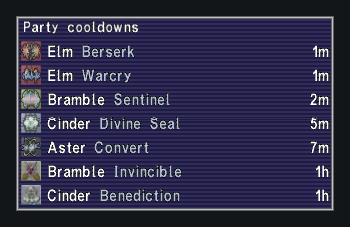

### Phantom Roll and pet

Both start off. **Phantom Roll** shows a roll's total, what it gives you, its lucky and unlucky numbers, the bust chance, the Double-Up time and who got it.

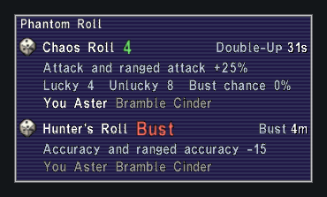

**Pet** shows your pet's HP, MP and TP, its effects, your pet command recasts, a charm's estimated time, a jug's time left and a PUP's maneuvers.

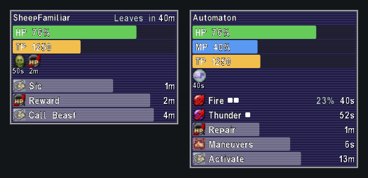

### Overhead icons

Overhead icons start off. They show buffs and debuffs above the heads of your target, the mobs your party fights, party members and your pet. They can sit in one bar, in two lines, or with buffs and debuffs on either side, and each kind of unit gets its own layout, limits and filters. The icons follow heads, size with the unit on screen and can't be clicked.

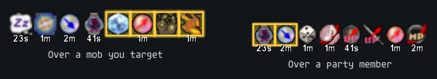

### Looks

There are ten skins, Original FFXI and XI View client artwork with all eight client window skins, 17 fonts plus your own, and countdown bold, shadow and outline for every display.

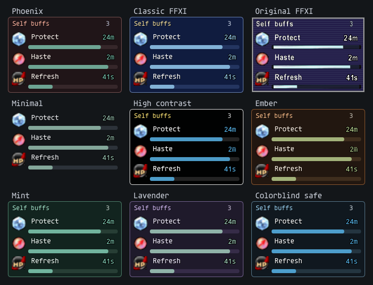

*The same panel in nine of the ten skins.*

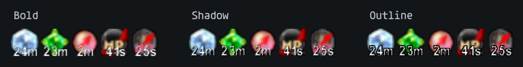

### Settings

Most of the settings are on the main page, in the order you set things up: **What to show**, **How it looks** and **Moving**.

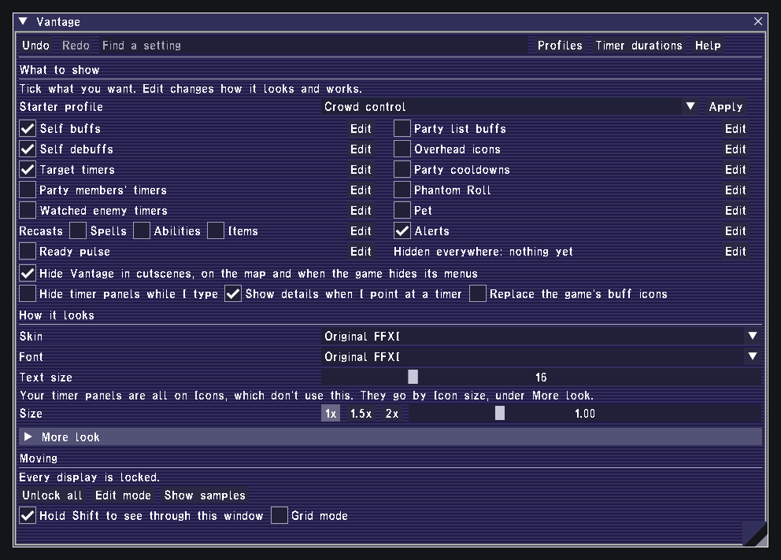

**Starter profiles** for melee, tanks, healers, support, crowd control and pet jobs turn on what that role wants in one step, and they keep your own look.

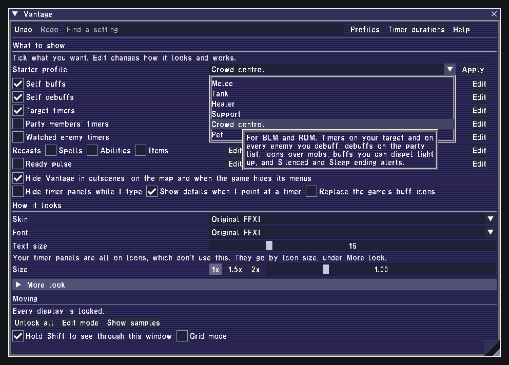

Each display's editor has its layout, fields, filters, colors and placement. It also has **When to show**, which can go by job, level, Level Sync, zone kind, solo, party or alliance, engaged and pet out.

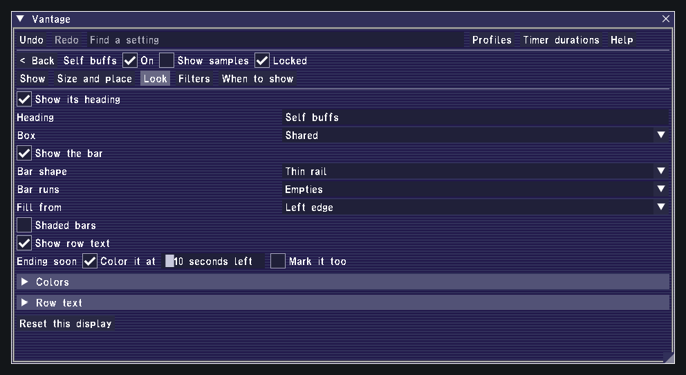

**Hidden everywhere** is one list of what's hidden on every display. You can hide Signet and Level Sync there, or add rules by effect, type, player name, job and group. Each display's own **Filters** include, exclude, pin and order effects. Hidden effects are still tracked for alerts.

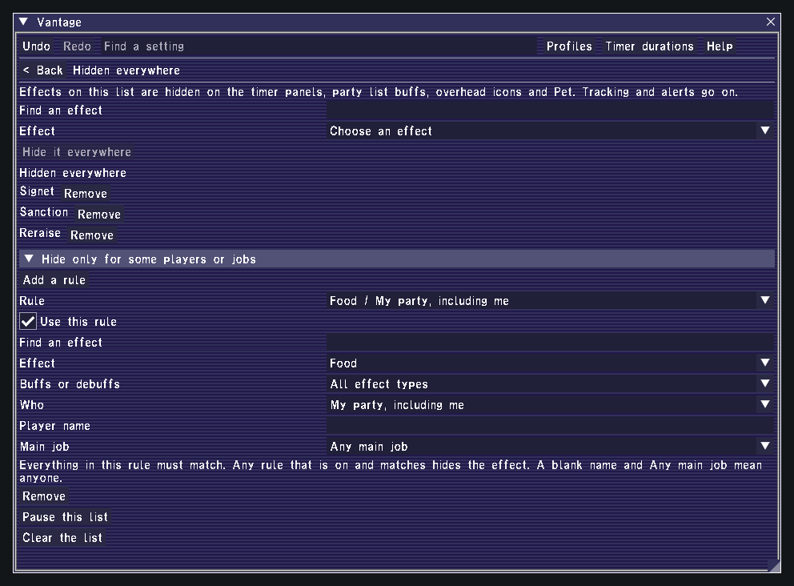

**Alerts** cover gains, remaining time, removals and missing effects. They can show as notices, row emphasis or a line in your chat log, or play your own WAV or MP3 sounds.

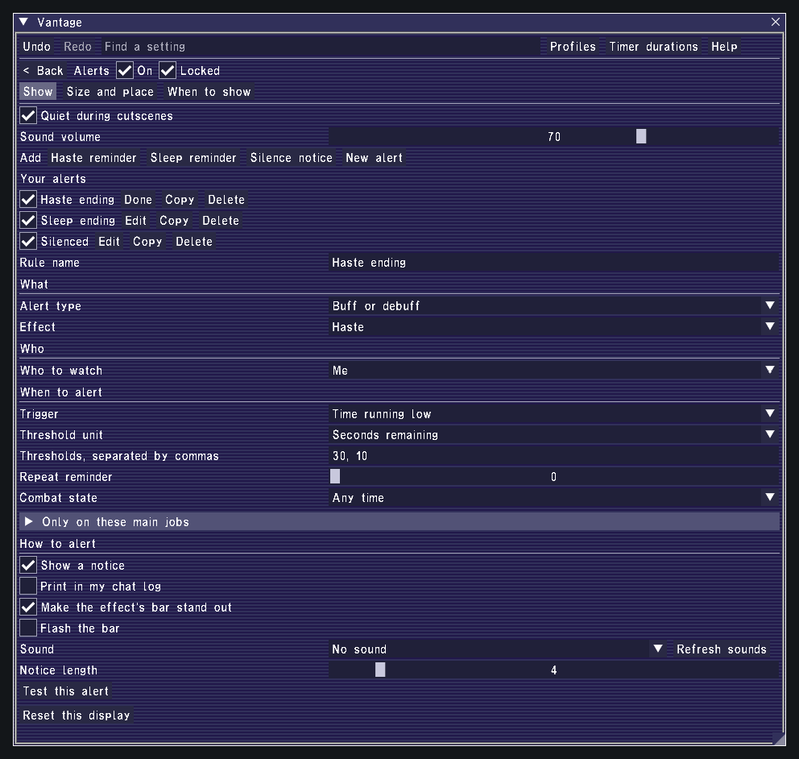

**Edit mode** (`/vg edit`) outlines every display so you can move it with Shift and the mouse or with the arrow keys. **Moves with** keeps a display next to a spot on the screen, another display, the party list or chat.

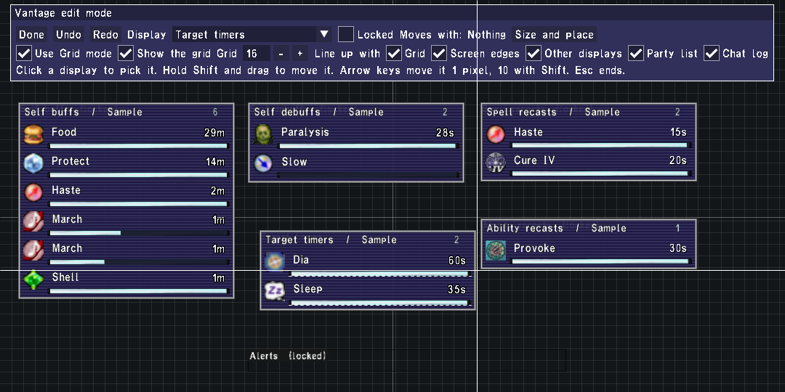

**Profiles** are named setups that every character can load, and each character can link them to its jobs. Your characters can also share where things are, or where things are and how they look. A reset can cover just one part of your setup and leave the rest alone. **Import and export** copies a display, where everything is, the Hidden everywhere list, alert rules or a whole profile as text that holds only data. When you import one, you can add it or replace what you have.

### What it knows and what it sends

Your own timers come from the game. For everyone else, Vantage shows what it saw cast, with an estimated countdown or none at all. So an enemy panel isn't a full list of that enemy's effects. [Read a timer](docs/GUIDE.md#read-a-timer) explains each kind.

Vantage doesn't send anything to the game. It never casts, uses items, changes your target or posts to chat.

## Source and license

The mechanics data follows [Phoenix's source](https://github.com/phoenixffxi/Phoenix) at revision [`071c401048`](https://github.com/phoenixffxi/Phoenix/commit/071c401048bdb97bcbe12ad93651574fcf867407). `docs/SOURCE_MANIFEST.json` lists every Phoenix file it uses. Vantage uses the [GNU GPL v3](LICENSE) for its source and data, except the addon's `core/json.lua`. That file is rxi's json.lua 0.1.2, under the MIT license in its header. Vantage's copy adds stricter decoding (surrogate pairs, number syntax and trailing commas) and reads strings with escapes in one pass. The icons, window art and game font in the example images belong to Square Enix. Vantage reads them from your installed client, and its zip holds no game artwork, fonts or sounds.
